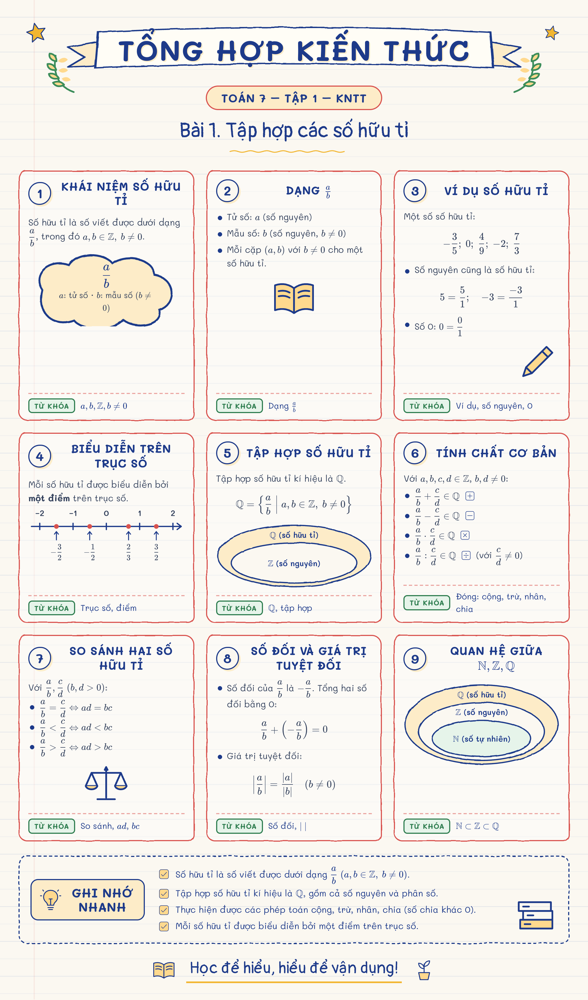

# sketchnote-vn — Poster "Tổng hợp kiến thức" vẽ tay

Skill cho Claude Code biến một tài liệu thành poster ôn tập kiểu sketchnote. Đầu vào có thể là PDF, Word, ảnh chụp sách, link hoặc đoạn văn.

Poster gồm:
- Tiêu đề dạng băng rôn.
- 6–9 thẻ đánh số, mỗi thẻ có **TỪ KHÓA**.
- Icon doodle.
- Khung **GHI NHỚ NHANH**.
- Nền giấy kẻ.

Poster được dựng bằng **HTML + KaTeX rồi chụp thành PNG**, không dùng AI vẽ ảnh. Nhờ vậy, dấu tiếng Việt, phân số và các kí hiệu ℚ ℤ ℕ luôn đúng.



## Cài đặt

```bash
git clone https://github.com/truongnh28/artifact.git
mkdir -p ~/.claude/skills
cp -R artifact/sketchnote-vn ~/.claude/skills/
```

Yêu cầu: Node ≥ 22 và Google Chrome, Chromium hoặc Edge. Font và KaTeX đã đóng gói sẵn, nên chạy được khi offline.

## Dùng

Trong Claude Code, gửi tài liệu kèm một câu như:

> Làm cho em một tấm tổng hợp kiến thức kiểu vẽ tay từ bài này nhé

Skill tự đọc tài liệu, chắt lọc ý, viết file nội dung `*.json`, rồi render ra `*.png`.

Bạn cũng có thể tự sửa file JSON rồi build lại:

```bash
node ~/.claude/skills/sketchnote-vn/scripts/build.mjs bai.json --png            # PNG
node ~/.claude/skills/sketchnote-vn/scripts/build.mjs bai.json --png --a4       # thêm PDF A4 để in
node ~/.claude/skills/sketchnote-vn/scripts/build.mjs bai.json --png --theme chalkboard
```

**Theme:** `blue-ink` (mặc định), `pastel-journal`, `chalkboard`, `print-bw`.

**Hình minh hoạ:** `formula`, `equation` (phương trình chữ), `graph` (đồ thị), `numberline`, `nested` (tập hợp lồng nhau), `steps`, `table`, `compare`, `icon`.

Chi tiết schema nằm trong [`sketchnote-vn/references/blueprint-schema.md`](sketchnote-vn/references/blueprint-schema.md).

## Poster mẫu

| Môn | Poster | Nội dung (JSON) |
|---|---|---|
| Toán 7 – Tập hợp các số hữu tỉ | [PNG](posters/toan-7/toan7-so-huu-ti.png) | [JSON](posters/toan-7/toan7-so-huu-ti.json) |
| KHTN 7 – Quang hợp ở thực vật | [PNG](posters/khtn-7/khtn7-quang-hop.png) | [JSON](posters/khtn-7/khtn7-quang-hop.json) |
| Vật lí 10 – Chuyển động thẳng biến đổi đều (bảng đen) | [PNG](posters/vat-li-10/vatli10-chuyen-dong-thang-bien-doi-deu.png) · [PDF](posters/vat-li-10/vatli10-chuyen-dong-thang-bien-doi-deu.pdf) | [JSON](posters/vat-li-10/vatli10-chuyen-dong-thang-bien-doi-deu.json) |
| Tiếng Anh 7 – Ngữ pháp Unit 1–6 | [PNG](posters/tieng-anh-7/01-ngu-phap-unit-1-6.png) | [JSON](posters/tieng-anh-7/01-ngu-phap-unit-1-6.json) |
| Tiếng Anh 7 – Ngữ pháp Unit 7–12 | [PNG](posters/tieng-anh-7/02-ngu-phap-unit-7-12.png) | [JSON](posters/tieng-anh-7/02-ngu-phap-unit-7-12.json) |

Nội dung poster tiếng Anh tóm tắt từ bài *Ngữ pháp tiếng Anh lớp 7 Global Success* trên apollo.edu.vn.

## Nguồn ý tưởng và giấy phép

Xem [`sketchnote-vn/CREDITS.md`](sketchnote-vn/CREDITS.md).
- KaTeX: giấy phép MIT.
- Font Mali, Pangolin, Itim, Patrick Hand: giấy phép SIL OFL 1.1.
